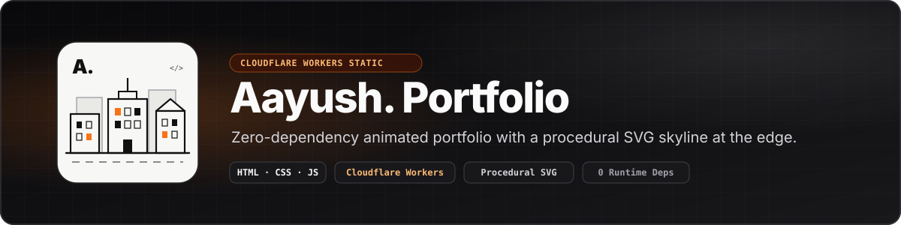
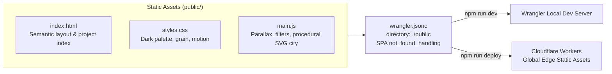

<p align="center">
  
</p>

<p align="center">
  
  
  
  
  
</p>

<p align="center">
  <a href="#overview">Overview</a> ·
  <a href="#architecture--deployment">Architecture &amp; Deployment</a> ·
  <a href="#highlights">Highlights</a> ·
  <a href="#quick-start">Quick Start</a> ·
  <a href="#project-structure">Project Structure</a> ·
  <a href="#customization">Customization</a>
</p>

---

# Portfolio

Personal portfolio for [Aayush](https://github.com/aayushhzz) (Platform & AI Engineer), built with pure HTML, CSS, and vanilla JavaScript — zero frontend frameworks or runtime dependencies — and served globally from **Cloudflare Workers Static Assets**.

## Overview

The site pairs a dark editorial layout (`Inter Tight` + `JetBrains Mono` + animated SVG film grain) with lightweight, accessible motion (`prefers-reduced-motion` aware) and a procedural ink cityscape footer that draws itself when scrolled into view.

## Architecture & Deployment



## Highlights

- **Floating Glassmorphic Navigation:** Fixed pill header with smooth section links (`Work`, `Projects`, `Experience`, `Skills`, `Contact`).
- **Scroll-Driven Hero:** `< SOFTWARE ENGINEER />` typographic title screen with `requestAnimationFrame` scroll parallax, fade-out, and grayscale portrait hover scale.
- **Featured & Filterable Project Index:** Showcases 3 featured agent systems (`autodev`, `Incident Triage Agent`, `Quorum`) followed by a filterable 22-project directory with live per-category counts (`All`, `AI & Agents`, `Tooling & Infra`, `Apps & Tools`, `Web3 & Open Source`, `Hackathons`).
- **Procedural Ink Cityscape Footer:** Deterministic seeded PRNG (`seed = 20261119`) in [`public/main.js`](public/main.js) generates layered buildings, roofs, trees, window grids, animated cars, and birds in SVG, triggered via `IntersectionObserver` with flickering lit windows.
- **Accessible & Lightweight:** Respects `prefers-reduced-motion`, uses `IntersectionObserver` for scroll reveals, and ships with zero client-side packages.

## Quick Start

Requires [Node.js](https://nodejs.org/) and a Cloudflare account (for deployment).

```bash
# Install Wrangler CLI (devDependency)
npm install

# Run local preview via Wrangler
npm run dev

# Deploy static assets to Cloudflare Workers
npm run deploy
```

## Project Structure

```text
portfolio/
├── assets/
│   └── banner.svg          # Repository hero banner
├── public/
│   ├── index.html          # Markup: hero, intro, ticker, projects, experience, toolkit, footer
│   ├── styles.css          # Dark theme, film grain, animations, responsive layout
│   └── main.js             # Scroll reveals, parallax, category filters, procedural SVG skyline
├── package.json            # dev/deploy scripts and wrangler dependency
└── wrangler.jsonc          # Cloudflare Workers static assets configuration
```

Key files:
- [`public/index.html`](public/index.html) — page content, featured work, project rows, experience, education, and contact links.
- [`public/styles.css`](public/styles.css) — CSS variables, grain overlay, ticker keyframes, and responsive breakpoints.
- [`public/main.js`](public/main.js) — interactive category filtering and deterministic SVG skyline generator.
- [`wrangler.jsonc`](wrangler.jsonc) — Workers asset directory (`./public`) and `single-page-application` fallback config.
- [`package.json`](package.json) — `wrangler dev` and `wrangler deploy` scripts.

## Customization

- **Add or edit projects:** Update the `<li data-cat="...">` entries inside `#project-rows` in [`public/index.html`](public/index.html); category counts update automatically in [`public/main.js`](public/main.js).
- **Add work experience:** Append another `<article class="job reveal">` block inside `#experience` in [`public/index.html`](public/index.html).
- **Change the skyline seed:** Adjust `let seed = 20261119;` in [`public/main.js`](public/main.js) to generate a different deterministic city silhouette.
